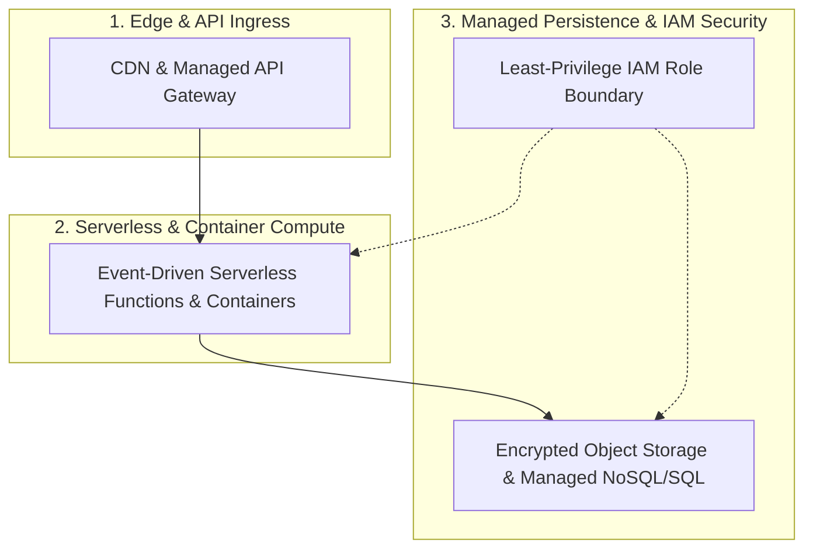

# AWS Cloud Solutions & Multi-Cloud Architecture Patterns

> **Author & Architect:** [Robina Mirbahar](https://github.com/RobinaMirbahar) (Google Developer Expert in Cloud & AI)  
> **Focus:** Reference Architectures, Serverless Microservices & High-Availability Cloud Patterns Across AWS & Multi-Cloud Environments

---

## 🎯 Why I Built AWS Cloud Solutions & Multi-Cloud Architecture Patterns (Engineering Purpose & Real-World Value)

### 1. ☁️ Practical Multi-Cloud Architecture Blueprints
As a Cloud & AI Architect, I frequently map workloads across Google Cloud and AWS. I created this repository to document clean, reusable cloud solution patterns covering serverless compute, VPC isolation, IAM least privilege, and resilient storage.

### 2. 🔒 Security-First Infrastructure Design
Every reference pattern emphasizes encrypted data flows, scoped service roles, and automated health checks.

### 3. ⚡ Concise Reference for Cloud Builders
Structured as a quick-reference hub for comparing and implementing cloud-native infrastructure components.

---

## 🏗️ System Architecture

---

 
   <h2 align="center"> AWS Cloud Soultions  </h2>

   

   

- <a href="https://github.com/RobinaMirbahar/AWS-Cloud-Solutions/blob/main/S3%20in%20Parquet%20format%20in%20Python%20(or%20Typescript).py">S3 in Parquet format in Python or Typescript without spark</a>

- <a href="https://github.com/RobinaMirbahar/AWS-Cloud-Solutions/blob/main/AppSyc%20with%20node%20js%20and%20subscribe%20event%20function">AppSync with node js and subscribe event function</a>

- <a href="https://github.com/RobinaMirbahar/AWS-Cloud-Solutions/blob/main/Ingest%20Prometheus%20logs%20from%20TeamCity%20into%20Cloudwatch%3F">Ingest Prometheus logs from TeamCity into Cloudwatch</a>

- <a href="https://github.com/RobinaMirbahar/AWS-Cloud-Solutions/blob/main/Attach%20Public%20IP%20Addresses%20to%20network%20Interface%20Boto3.py">Attach Public IP Addresses to network Interface Boto3</a>

## Have any Questions?

Want to request a new topic for a demo? [Open an Issue](https://github.com/RobinaMirbahar/AWS-Cloud-Solutions/issues/new/choose)

## Want to Contribute? Open a Pull Request!

<!-- AUTHOR_SIGNATURE_START -->
---

## 👩‍💻 About the Author

**Robina Mirbahar — Google Cloud & AI Architect**  
*Google Developer Expert (GDE) in Cloud & AI • Published Author • Multi-Agent Systems & Serverless GPU Builder*

<!-- AUTHOR_SIGNATURE_END -->
